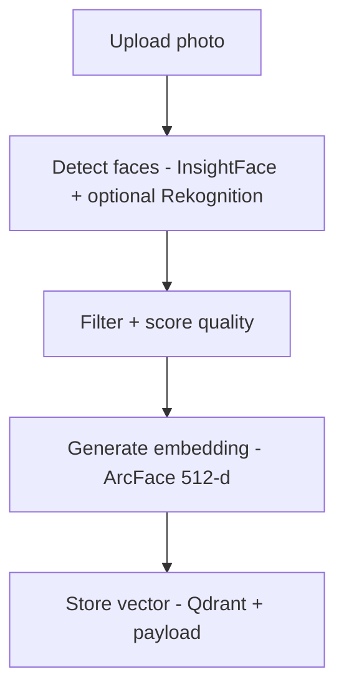
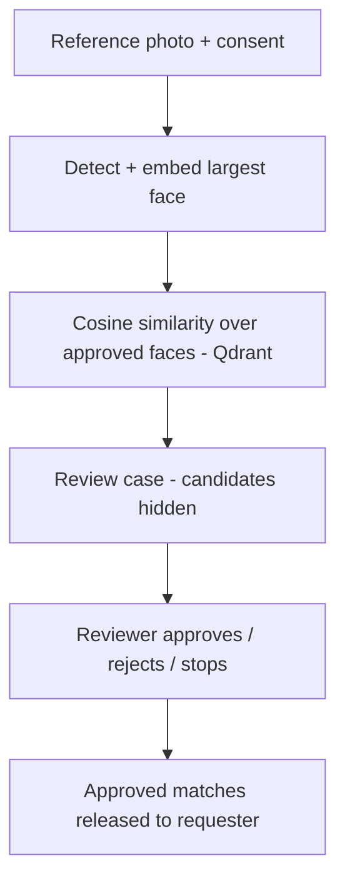

# Face Search App

Upload a photo of someone, get back every photo in your library that they appear in.

A face-recognition photo search built to explore the tradeoff between managed cloud vision APIs and open-source computer-vision models - combining both where each is the better tool.

> **Biometric system - read [GOVERNANCE.md](./GOVERNANCE.md) first.** Intended only for private, consented photo collections. Surveillance, identifying strangers, scraped images and high-impact decisions are prohibited. Every photo is approved by a human reviewer before it is searchable, and every match is verified by a human before it is shown.

## Governance

| | |
|---|---|
| Accountable owner | @laavanjan ([GOVERNANCE.md](./GOVERNANCE.md)) |
| Risk tier | High - [risk assessment](./docs/risk/risk-assessment.md), [risk register](./docs/risk/risk-register.md) |
| Human oversight | [docs/oversight/human-oversight.md](./docs/oversight/human-oversight.md) |
| Appeals & SLA | `/appeal` in the app - [docs/oversight/appeals-and-sla.md](./docs/oversight/appeals-and-sla.md) |
| Privacy & AI use | `/privacy` in the app - [docs/privacy/privacy-and-ai-use.md](./docs/privacy/privacy-and-ai-use.md) |
| Retention | [docs/privacy/data-retention-policy.md](./docs/privacy/data-retention-policy.md) |
| All artefacts | [docs/README.md](./docs/README.md) |

## How it works

The system splits detection and recognition into two separate concerns, each handled by the tool best suited to it:

**Indexing**



Faces are stored as `pending` and only become searchable after a reviewer approves the photo.

**Search**



Rekognition (when AWS is configured) contributes bounding-box quality scoring; identity matching is always done by ArcFace so we don't pay per-image for recognition. When AWS is blank, InsightFace handles both jobs - the app is fully usable locally with no cloud accounts.

## Tech stack

| Layer | Tool |
|---|---|
| Face detection + quality scoring | InsightFace (`buffalo_l`) - optional Amazon Rekognition |
| Face embedding | InsightFace / ArcFace (512-d) |
| Vector search | Qdrant (cloud, self-hosted, or in-memory) |
| Backend | FastAPI + Mangum (Lambda-ready) |
| Photo storage | Amazon S3 - local disk fallback |
| Frontend | Next.js 14 (App Router) + Tailwind |

## Repo layout

```
backend/
  app/
    main.py              FastAPI app + Mangum handler
    config.py            pydantic-settings, feature toggles, governance settings
    security.py          API-key auth + role-based permissions
    logging_setup.py     log redaction of personal data
    routes/              upload - search - photos - gallery - review - appeals - admin
    services/
      face_engine.py     InsightFace loader + analyzer
      rekognition.py     Optional AWS quality scorer
      storage.py         S3 / local filesystem (private)
      vector_store.py    Qdrant client (cloud / memory)
      pipeline.py        sanitize -> detect -> embed -> upsert / search
      review.py          human approval gates (indexing + disclosure)
      controls.py        stop switch + config-change approval gate
      appeals.py         recourse
      retention.py       deletion + TTL sweep
      db.py, audit.py    governance store + audit log
    jobs/retention.py    one-shot retention sweep (cron / EventBridge)
  tests/                 pytest, synthetic data only, no model download
  Dockerfile
frontend/
  app/                   /, /search, /gallery, /review, /admin, /appeal, /privacy, /signin
  components/            Dropzone, StatusBar, AuthImage, AppealForm, ConsentCheck, NavAuth
  lib/                   typed API client + session hook
docs/                    governance, risk, oversight, privacy, change records
scripts/                 governance document check
docker-compose.yml       backend + qdrant + frontend
```

## Getting started

The app runs **with zero AWS credentials** - S3 falls back to local disk, Rekognition is skipped, and Qdrant runs in-memory. Set env vars later to graduate any of those to their cloud counterpart.

Every data endpoint needs an access key. `backend/.env.example` ships three example keys (operator, reviewer, admin) - **replace the tokens** before anyone else can reach the app. Sign in at http://localhost:3000/signin. Because a reviewer cannot approve their own work, try the flow with two keys: upload and search as the operator, approve as the reviewer.

### Backend

```bash
cd backend
python -m venv .venv
.venv\Scripts\activate           # Windows
pip install -r requirements.txt
copy .env.example .env
uvicorn app.main:app --reload
```

First request downloads the InsightFace `buffalo_l` model (~280 MB) into `~/.insightface`.

### Frontend

```bash
cd frontend
npm install
npm run dev
```

Open http://localhost:3000. `/api/*` and `/photos/*` are proxied to the backend.

### Environment variables

AWS / Qdrant are optional - leave blank for local mode. See `backend/.env.example` for the full list (access keys, review gates, legal basis, retention, timeouts).

```
API_KEYS=name:role:token,...     # roles: viewer, operator, reviewer, admin
DATA_PROCESSING_LEGAL_BASIS=consent
PHOTO_RETENTION_DAYS=90
REQUIRE_INDEX_REVIEW=true
SEARCH_MIN_THRESHOLD=0.35
AWS_ACCESS_KEY_ID=
AWS_SECRET_ACCESS_KEY=
AWS_REGION=
S3_BUCKET_NAME=
QDRANT_URL=                # blank -> in-memory qdrant
QDRANT_API_KEY=
QDRANT_COLLECTION=faces
MIN_FACE_SIZE=40
MIN_DET_SCORE=0.5
LOCAL_PHOTO_DIR=./data/photos
ALLOWED_ORIGINS=http://localhost:3000
```

### One-command dev with Docker

```bash
docker compose up --build
```

Spins up Qdrant, the FastAPI backend, and the Next.js frontend on `:3000`.

## API

Send `Authorization: Bearer <token>`. Permission in brackets.

| Method | Path | Body | Description |
|---|---|---|---|
| POST | `/upload` | multipart `file`, `consent` | [photos:write] Sanitize, detect, embed; faces stay `pending` until approved. |
| POST | `/search` | multipart `file`, `limit`, `threshold`, `consent` | [photos:search] Opens a review case; no matches returned yet. |
| GET | `/search/cases/{case_id}` | -- | Requester sees approved matches once the case is completed. |
| GET | `/photos/{photo_id}` | -- | [photos:read] Fetch stored photo. |
| DELETE | `/photos/{photo_id}?reason=` | -- | [photos:delete] Erase photo + all its vectors. |
| GET | `/gallery?limit=100` | -- | [photos:read] Indexed photos with review status and expiry. |
| GET/POST | `/review/photos`, `/review/photos/{id}` | `decision`, `reason` | [review:decide] Indexing approval queue. |
| GET/POST | `/review/cases/...` | see docs | [review:decide] Approve/reject candidates, manual match, complete/stop/escalate/reopen. |
| POST | `/appeals` | `category`, `reason`, refs, `contact` | Public. File an appeal; restricts the referenced photo. |
| GET | `/appeals/{id}` | -- | Public appeal status. |
| GET/POST | `/appeals`, `/appeals/{id}/resolve` | | [appeals:manage] Appeal queue. |
| GET/POST | `/admin/controls`, `/admin/config/approve`, `/admin/retention/run`, `/admin/audit` | | [system:control / audit:read] Stop switch, config approval, retention, audit log. |
| GET | `/policy` | -- | Public processing record (legal basis, retention, SLA). |
| GET | `/health` | -- | Status, pause state, config approval. |

Interactive docs live at `/docs`.

## Tests

```bash
cd backend
pytest
```

Tests mock the InsightFace model and use only synthetic data ([docs/privacy/synthetic-data.md](./docs/privacy/synthetic-data.md)), so they run without downloading anything. They cover access control, the review gates, appeals, deletion, retention, metadata stripping and log redaction.

## Deploy notes

- `mangum` is wired up in `app/main.py`; ship the same container image to Lambda with an ARM64 image and set the handler to `app.main.handler`.
- Frontend deploys anywhere static (Vercel, Amplify, Firebase Hosting).
- Use Qdrant Cloud's 1 GB free cluster for production vector search; drop the URL and API key into the env vars.
- Enabling AWS or Qdrant Cloud is a data transfer: complete [docs/privacy/cross-border-transfer-assessment.md](./docs/privacy/cross-border-transfer-assessment.md) first. Changing these settings pauses indexing and search until an admin approves the change.
- On Lambda there is no long-lived process for the retention sweeper: schedule `python -m app.jobs.retention` hourly.
- `buffalo_l` weights are licensed for non-commercial research only - see [docs/privacy/training-data.md](./docs/privacy/training-data.md).

## Roadmap

See [TASKS.md](./TASKS.md). Phase 0-5 are wired up; deployment and portfolio polish are next.

## License

Code: MIT. The InsightFace `buffalo_l` model weights downloaded at runtime have their own non-commercial terms - see [docs/privacy/training-data.md](./docs/privacy/training-data.md).
