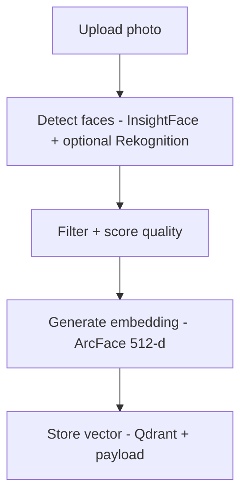
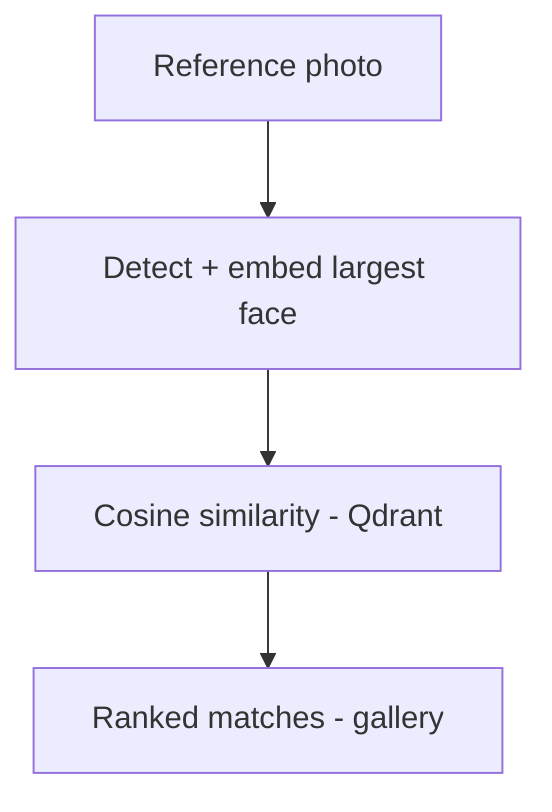

# Face Search App

Upload a photo of someone, get back every photo in your library that they appear in.

A face-recognition photo search built to explore the tradeoff between managed cloud vision APIs and open-source computer-vision models - combining both where each is the better tool.

## How it works

The system splits detection and recognition into two separate concerns, each handled by the tool best suited to it:

**Indexing**



**Search**



Rekognition (when AWS is configured) contributes bounding-box quality scoring; identity matching is always done by ArcFace so we don't pay per-image for recognition. When AWS is blank, InsightFace handles both jobs - the app is fully usable locally with no cloud accounts.

## Tech stack

| Layer | Tool |
|---|---|
| Face detection + quality scoring | InsightFace (`buffalo_l`) - optional Amazon Rekognition |
| Face embedding | InsightFace / ArcFace (512-d) |
| Vector search | Qdrant (cloud, self-hosted, or in-memory) |
| Backend | FastAPI + Mangum (Lambda-ready) |
| Photo storage | Amazon S3 - local disk fallback |
| Frontend | Next.js 14 (App Router) + Tailwind |

## Repo layout

```
backend/
  app/
    main.py              FastAPI app + Mangum handler
    config.py            pydantic-settings, feature toggles
    routes/              upload - search - photos - gallery
    services/
      face_engine.py     InsightFace loader + analyzer
      rekognition.py     Optional AWS quality scorer
      storage.py         S3 / local filesystem
      vector_store.py    Qdrant client (cloud / memory)
      pipeline.py        detect -> embed -> upsert / search
  tests/                 pytest, no model download required
  Dockerfile
frontend/
  app/                   /, /search, /gallery (App Router)
  components/            Dropzone, StatusBar
  lib/api.ts             typed API client
docker-compose.yml       backend + qdrant + frontend
```

## Getting started

The app runs **with zero AWS credentials** - S3 falls back to local disk, Rekognition is skipped, and Qdrant runs in-memory. Set env vars later to graduate any of those to their cloud counterpart.

### Backend

```bash
cd backend
python -m venv .venv
.venv\Scripts\activate           # Windows
pip install -r requirements.txt
copy .env.example .env
uvicorn app.main:app --reload
```

First request downloads the InsightFace `buffalo_l` model (~280 MB) into `~/.insightface`.

### Frontend

```bash
cd frontend
npm install
```

### Environment variables

Create a `.env` file in the backend directory:

```
AWS_ACCESS_KEY_ID=
AWS_SECRET_ACCESS_KEY=
AWS_REGION=
S3_BUCKET_NAME=
QDRANT_URL=
QDRANT_API_KEY=
```

### Running locally

```bash
uvicorn main:app --reload
```

## Project status

This project is being built in phases - see [TASKS.md](./TASKS.md) for the full breakdown, from local detection/embedding through deployment.

## Cost

Designed to run entirely within free-tier limits at small scale (under ~1,000 photos): AWS Lambda, S3, and Rekognition's free tier, plus Qdrant Cloud's free 1GB cluster. See notes in TASKS.md for what happens to Rekognition costs after its 12-month free tier window.

## License

MIT
