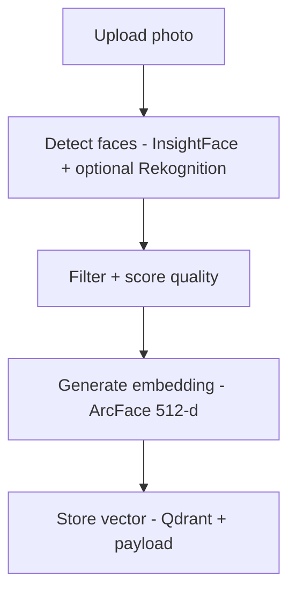
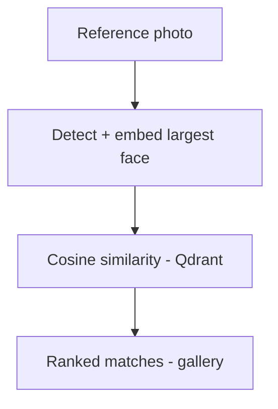

# Face Search App

Upload a photo of someone, get back every photo in your library that they appear in.

A face-recognition photo search built to explore the tradeoff between managed cloud vision APIs and open-source computer-vision models - combining both where each is the better tool.

## How it works

The system splits detection and recognition into two separate concerns, each handled by the tool best suited to it:

**Indexing**



**Search**



Rekognition (when AWS is configured) contributes bounding-box quality scoring; identity matching is always done by ArcFace so we don't pay per-image for recognition. When AWS is blank, InsightFace handles both jobs - the app is fully usable locally with no cloud accounts.

## Tech stack

| Layer | Tool |
|---|---|
| Face detection + quality scoring | InsightFace (`buffalo_l`) - optional Amazon Rekognition |
| Face embedding | InsightFace / ArcFace (512-d) |
| Vector search | Qdrant (cloud, self-hosted, or in-memory) |
| Backend | FastAPI + Mangum (Lambda-ready) |
| Photo storage | Amazon S3 - local disk fallback |
| Frontend | Next.js 14 (App Router) + Tailwind |

## Repo layout

```
backend/
  app/
    main.py              FastAPI app + Mangum handler
    config.py            pydantic-settings, feature toggles
    routes/              upload - search - photos - gallery
    services/
      face_engine.py     InsightFace loader + analyzer
      rekognition.py     Optional AWS quality scorer
      storage.py         S3 / local filesystem
      vector_store.py    Qdrant client (cloud / memory)
      pipeline.py        detect -> embed -> upsert / search
  tests/                 pytest, no model download required
  Dockerfile
frontend/
  app/                   /, /search, /gallery (App Router)
  components/            Dropzone, StatusBar
  lib/api.ts             typed API client
docker-compose.yml       backend + qdrant + frontend
```

## Getting started

The app runs **with zero AWS credentials** - S3 falls back to local disk, Rekognition is skipped, and Qdrant runs in-memory. Set env vars later to graduate any of those to their cloud counterpart.

### Backend

```bash
cd backend
python -m venv .venv
.venv\Scripts\activate           # Windows
pip install -r requirements.txt
copy .env.example .env
uvicorn app.main:app --reload
```

First request downloads the InsightFace `buffalo_l` model (~280 MB) into `~/.insightface`.

### Frontend

```bash
cd frontend
npm install
npm run dev
```

Open http://localhost:3000. `/api/*` and `/photos/*` are proxied to the backend.

### Environment variables

Everything is optional. Leave blank for local mode.

```
AWS_ACCESS_KEY_ID=
AWS_SECRET_ACCESS_KEY=
AWS_REGION=
S3_BUCKET_NAME=
QDRANT_URL=                # blank -> in-memory qdrant
QDRANT_API_KEY=
QDRANT_COLLECTION=faces
MIN_FACE_SIZE=40
MIN_DET_SCORE=0.5
LOCAL_PHOTO_DIR=./data/photos
ALLOWED_ORIGINS=http://localhost:3000
```

### One-command dev with Docker

```bash
docker compose up --build
```

Spins up Qdrant, the FastAPI backend, and the Next.js frontend on `:3000`.

## API

| Method | Path | Body | Description |
|---|---|---|---|
| POST | `/upload` | multipart `file` | Detect, embed, index every face in the photo. |
| POST | `/search` | multipart `file`, `limit`, `threshold` | Return matching photos by cosine similarity. |
| GET | `/photos/{photo_id}` | -- | Fetch stored photo (S3 or local). |
| GET | `/gallery?limit=100` | -- | Distinct indexed photos. |
| GET | `/health` | -- | Status + which backends are active. |

Interactive docs live at `/docs`.

## Tests

```bash
cd backend
pytest
```

Tests mock the InsightFace model so they run without downloading anything.

## Deploy notes

- `mangum` is wired up in `app/main.py`; ship the same container image to Lambda with an ARM64 image and set the handler to `app.main.handler`.
- Frontend deploys anywhere static (Vercel, Amplify, Firebase Hosting).
- Use Qdrant Cloud's 1 GB free cluster for production vector search; drop the URL and API key into the env vars.

## Roadmap

See [TASKS.md](./TASKS.md). Phase 0-5 are wired up; deployment and portfolio polish are next.

## License

MIT
