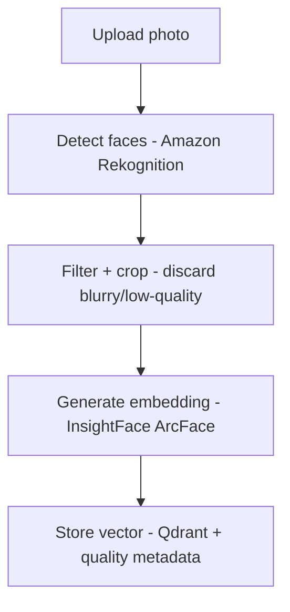
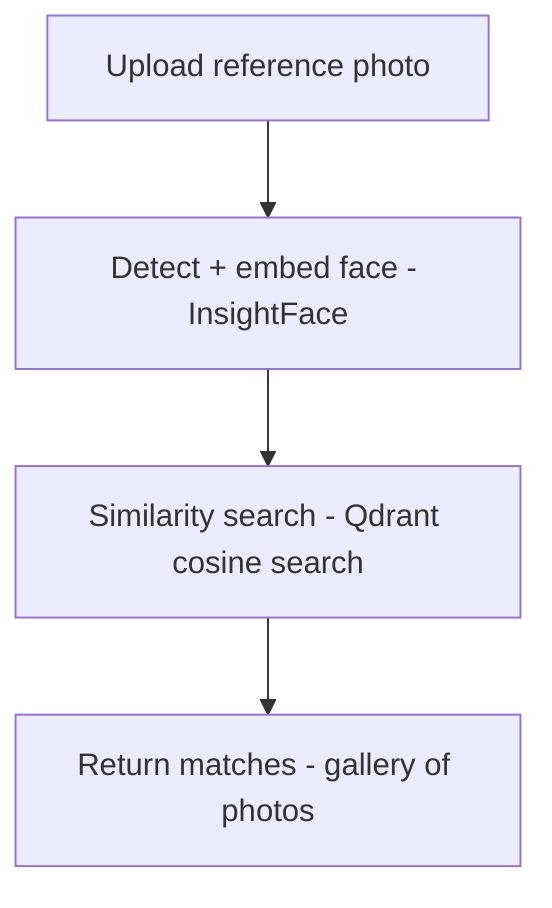

# Face Search App

Upload a photo of someone, get back every photo in your library that they appear in.

A face-recognition photo search built to explore the tradeoff between managed cloud vision APIs and open-source computer-vision models - combining both where each is the better tool.

## How it works

The system splits detection and recognition into two separate concerns, each handled by the tool best suited to it:

**Indexing**



**Search**



Amazon Rekognition handles face detection and quality scoring (blur, lighting) - it's fast, managed, and free at this project's scale. It does *not* do identity matching, so the actual "is this the same person" work is done by an open-source embedding model (InsightFace / ArcFace) running locally, with Qdrant handling the similarity search. Neither tool is asked to do the job the other one does better.

## Tech stack

| Layer | Tool |
|---|---|
| Face detection + quality scoring | Amazon Rekognition |
| Face embedding | InsightFace (ArcFace) |
| Vector search | Qdrant Cloud |
| Backend | FastAPI, deployed on AWS Lambda (via Mangum) |
| Photo storage | Amazon S3 |
| Frontend | Next.js |

## Getting started

```bash
# clone
git clone https://github.com/laavanjan/face-search-app.git
cd face-search-app

# backend
python -m venv venv
source venv/bin/activate
pip install -r requirements.txt

# frontend
cd frontend
npm install
```

### Environment variables

Create a `.env` file in the backend directory:

```
AWS_ACCESS_KEY_ID=
AWS_SECRET_ACCESS_KEY=
AWS_REGION=
S3_BUCKET_NAME=
QDRANT_URL=
QDRANT_API_KEY=
```

### Running locally

```bash
uvicorn main:app --reload
```

## Project status

This project is being built in phases - see [TASKS.md](./TASKS.md) for the full breakdown, from local detection/embedding through deployment.

## Cost

Designed to run entirely within free-tier limits at small scale (under ~1,000 photos): AWS Lambda, S3, and Rekognition's free tier, plus Qdrant Cloud's free 1GB cluster. See notes in TASKS.md for what happens to Rekognition costs after its 12-month free tier window.

## License

MIT
